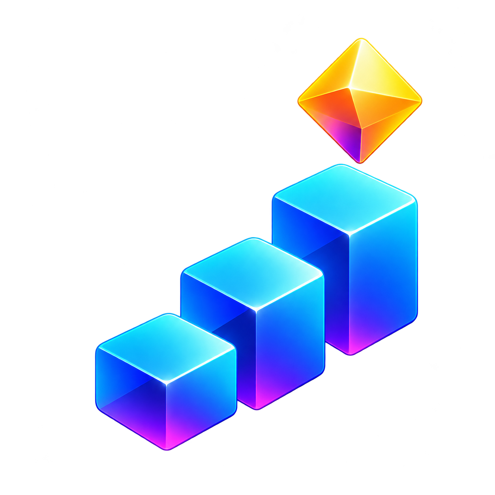

# Jump AI

**Give your coding agent a memory for useful tools—not just conversations.**

AI coding agents often write the same little programs over and over: inspect files, summarize tests, check changes, assemble reports. Jump AI lets an agent save that work as reusable programs, combine them into workflows, and run them again with a simple recipe.

The agent makes the decisions. Jump AI handles the repeatable steps.

**In one measured comparison, a prepared Jump AI workflow completed the same task in about half the time, using 35.6% fewer total tokens, including cached input.** This measured warm reuse and excluded one-time setup. [See the results and their limits](HOW_IT_WORKS.md).

[Install](#install-for-codex) · [Get started](#using-jump-ai) · [FAQ](FAQ.md) · [How it works](HOW_IT_WORKS.md) · [Developer guide](DEVELOPER_GUIDE.md)

## Install for Codex

This repository is private. On macOS or Linux, use **GitHub CLI (`gh`), Git, and Python 3.11+ with SQLite FTS5**. Sign in with `gh auth login` using an account with repository access, then run:

```sh
gh repo clone cashton-coleman/JumpAI "$HOME/JumpAI" && "$HOME/JumpAI/install.sh"
```

This installs the skill, reusable capabilities, and working standards using a checkout in `~/JumpAI`. Keep that folder in place, then **start a new Codex chat**. A C++17 compiler is optional.

Already have a complete checkout or extracted release? Run `./install.sh` from its directory. Anonymous `curl` installation is unavailable while the repository is private. For custom paths and prerequisites, see the [installation guide](skills/jumpai/references/installation.md).

## Using Jump AI

**Ask your agent for the work you want done.** For example:

> Diagnose the failing normalization test, make the smallest repair, and rerun that selected test.

> Inspect these Python functions and explain how they fit together.

> Review these files again after the latest changes and summarize what needs attention.

The installed instructions direct the agent to reuse matching tools and capture substantial reusable work without a separate reminder. The agent handles discovery, saving, and verification. [The FAQ explains how that automation works](FAQ.md#does-jump-ai-learn-automatically).

## Learn more

- [Frequently asked questions](FAQ.md): included tools, automatic reuse, compatibility, updates, and removal.
- [Results and how it works](HOW_IT_WORKS.md): measured savings, their limits, and the workflow approach.
- [Developer guide](DEVELOPER_GUIDE.md): commands, architecture, examples, and benchmark details.
- [Capability authoring](skills/jumpai/references/authoring.md): create programs and workflows.

Jump AI uses the [MIT license](LICENSE). Bundled third-party code retains its [original licenses and attribution](THIRD_PARTY_NOTICES.md).
